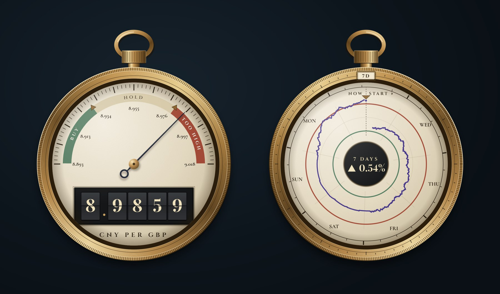
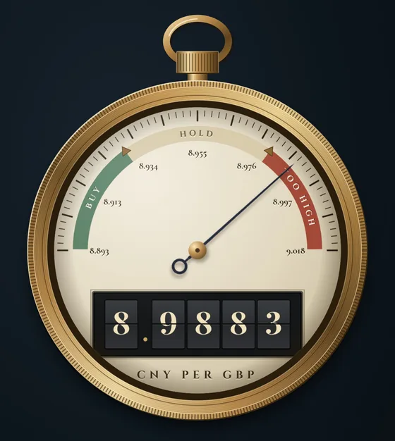
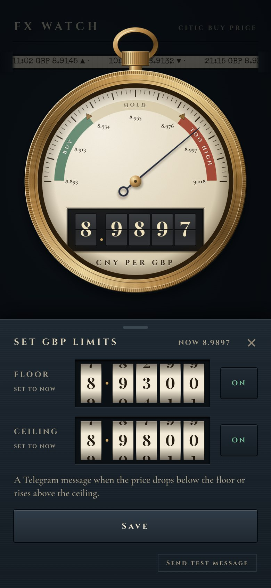
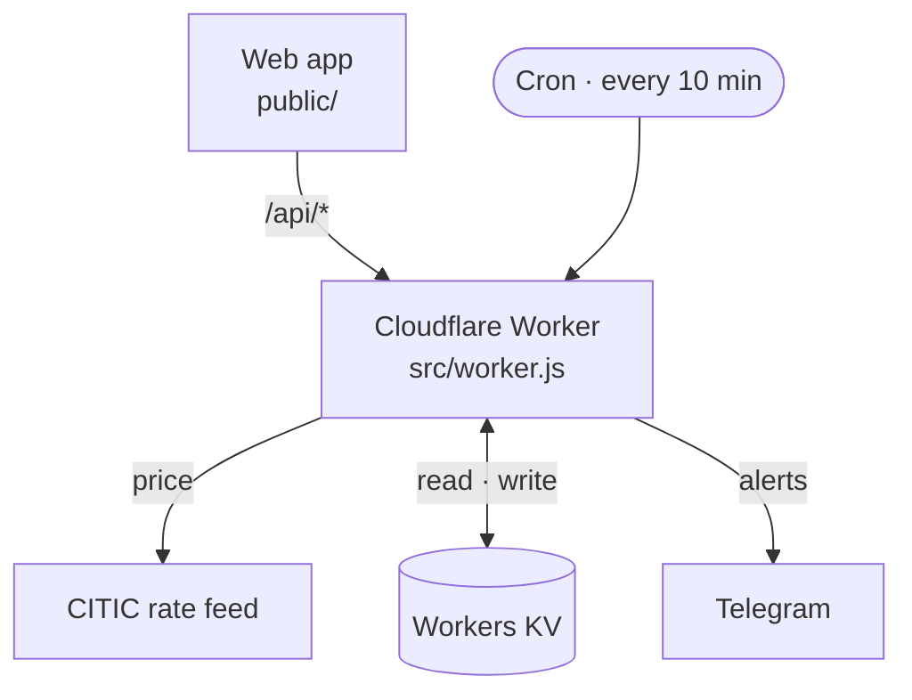

<div align="center">

# FX Watch

[](https://github.com/Ian9657/fx-watch/actions/workflows/test.yml)
[](LICENSE)

**English** | [简体中文](README.zh-CN.md)

**A pocket watch for one exchange rate.**

Watches China CITIC Bank's GBP and USD buy prices, keeps their history, and sends a Telegram message when a price crosses the floor or ceiling you set.

[**fx.etarc.net**](https://fx.etarc.net) · Cloudflare Workers · no dependencies, no build step

<br>



</div>

> [!NOTE]
> Prices come from the public feed behind the rate table on citicbank.com and are for reference only. The price shown in the CITIC app when you trade is final.

## Why

CITIC Bank publishes its current buy price and nothing else: no history and no alerts. If you're waiting for a good moment to change money, that means checking by hand. FX Watch checks every ten minutes, records each new quote, and tells you when the price is worth acting on.

## Features

### On the front

- **See where the price stands at a glance.** The needle sits on a dial banded **BUY · HOLD · TOO HIGH**, drawn from your own floor and ceiling.
- **Read the exact price** on number drums, with the change since yesterday's close and a ticker tape of recent quotes.
- **Switch currency with the knob**, and press the crown to wind the watch, which refreshes it.

### On the back

- **Turn the watch over for its history.** The back is a circular chart recorder covering 24 hours, 7, 30 or 90 days.
- **Turn the bezel to change the span**, shown in a date-style window at twelve.
- **See your limits on the chart** as two rings. When the market is closed, the trace holds the last price until a new quote arrives.

<p align="center"></p>

### Alerts

- **Set a floor and a ceiling for each currency** with number wheels. The dial previews the change before you save.
- **Get one message when a limit is crossed**, and a reminder every 4 hours while the price stays outside it. An alert re-arms only after the price comes back inside by more than 0.1%, so a price hovering at a limit doesn't keep alerting.
- **Know when checking stops.** If the 10-minute check keeps failing you're told, and told again when it recovers.

<p align="center"></p>

### Everyday use

- **Install it like an app** on the iPhone home screen or the Mac Dock. It opens offline with the last prices, marked OFFLINE.
- **Feel every control.** Quiet sounds and haptics throughout, with motion reduced when the system asks for it.

## Privacy

- **Locked by a password.** Each device asks for it once. Without it the API returns nothing, and the Worker compares it in constant time.
- **Your data stays in your own Cloudflare account.** Limits, alert state and price history live in your Workers KV, and history expires on its own after 92 days.
- **Nothing else is contacted.** The Worker talks only to the CITIC rate feed and, for alerts, Telegram. The page loads no third-party scripts, fonts or analytics.

## Design

The whole interface is a single pocket watch: navy, ivory, and one brass case. A few rules hold it together:

- **One light, from the upper left.** Every highlight and shadow on every part agrees with it
- **Every part is mounted.** Nothing floats on a drop shadow; parts sit in or on the watch
- **Gold belongs to the watch.** The rest of the page stays in the navy and ivory palette
- **Mechanical feel comes from behaviour, not ornament.** Drums roll, the bezel clicks round one way, the hand sweeps up from rest. No gears are painted on

The same rules open [`public/style.css`](public/style.css).

## How it works



| Part | Where |
|---|---|
| Web app: one ES module per part of the page (dial, tape, back, settings sheet, shared state, start-up) | `public/`, `public/js/` |
| API: `/api/rates`, `/api/history`, `/api/settings`, `/api/test` | `src/worker.js` |
| Feed parsing, alert rules, messages (pure functions, unit-tested) | `src/logic.js` |
| History: one KV record per Beijing day (`h:YYYY-MM-DD`), each expiring after 92 days, so a check reads and writes only today's record | Workers KV |
| Offline copy: network first, cached copy as fallback | `public/sw.js` |

Written in plain JavaScript, HTML and CSS: no framework, no bundler, no npm dependencies.

## Develop

```sh
echo 'EDIT_PASSWORD=localtest' > .dev.vars
npm run dev            # http://localhost:8787
npm test               # unit tests for the logic and the Worker
npm run check:screens  # with dev running: six screen sizes in headless Chrome
```

`check:screens` opens the app at phone and desktop sizes. At each size it checks that the app fits one screen and throws no errors, then turns the watch over, turns the knob, drags a wheel and opens the settings sheet. Screenshots are saved to `screens/`.

## Deploy

Pushing to `main` deploys through Cloudflare Workers Builds. The Worker name must stay `fx-watch`.

Set the following secrets in the Cloudflare dashboard (fx-watch → Settings → Variables and Secrets):

| Name | What |
|---|---|
| `EDIT_PASSWORD` | Password to open the app and change limits |
| `TELEGRAM_BOT_TOKEN` | From @BotFather |
| `TELEGRAM_CHAT_ID` | Your chat ID with the bot |

## Install

- **iPhone:** open the site in Safari → Share → Add to Home Screen
- **Mac:** open the site in Safari → File → Add to Dock

## Credits

Fonts (Cinzel, Cormorant Garamond, Playfair Display, Special Elite) are self-hosted under the SIL Open Font License.

## License

[MIT](LICENSE)
