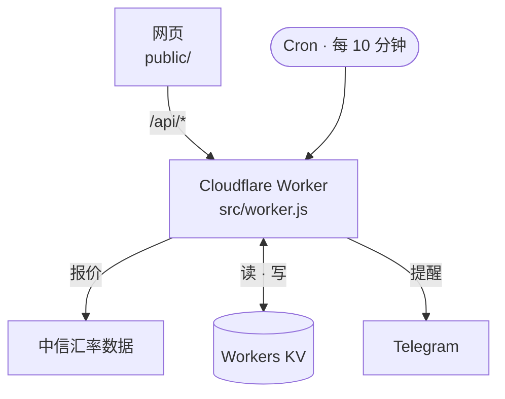

<div align="center">

# FX Watch

[](https://github.com/Ian9657/fx-watch/actions/workflows/test.yml)
[](LICENSE)

[English](README.md) | **简体中文**

单用户 Web 应用：跟踪中信银行 8 种货币的购汇价，记录历史，并在价格越过下限或上限时发送 Telegram 提醒。

[fx.etarc.net](https://fx.etarc.net) · Cloudflare Workers + KV · 原生 JS，零依赖，无构建步骤

<br>


</div>

> [!NOTE]
> 价格来自中信银行官网汇率表背后的公开数据，仅供参考，以交易时中信银行 App 中的价格为准。

中信只公布当前报价，没有历史数据，也没有提醒。Cron Trigger 每 10 分钟拉取一次报价，Worker 把每个新报价写入 KV（报价源中全部 20 种货币，购汇和结汇价），页面再从 KV 读回历史。

## 功能

**表盘（正面）**
- 指针位置由价格映射到以上下限构建的刻度上：下限对应 0.3，上限对应 0.7，结果限制在 [0.02, 0.98]。分为 BUY / HOLD / TOO HIGH 三段。
- 数字滚轮显示价格，附相对前一日最后报价的涨跌，顶部纸带显示最近 12 条记录。
- 8 种货币：USD、GBP、EUR、JPY、HKD、AUD、CAD、SGD。日元按每 100 日元计价，与中信报价一致。
- 旋钮上放 1 到 4 种，每种一盏灯，显示它所在的区间。点按跳到下一档；拖动则逐档转动，每档一声咔嗒。
- 表冠触发刷新。页面可见时每 30 秒自动刷新，获得焦点或从后台恢复时也会刷新。

**走势图（背面）**
- SVG 极坐标图：每个时段（24 小时、7 天、30 天、90 天）转一圈，时间从顶部顺时针推进，价格沿半径向外，刻度与表盘一致。
- 最多抽样到约 900 个点（90 天约有 13,000 条报价）。
- 报价在下一条出现前一直有效，所以休市期间（周末）曲线沿等半径圆弧保持原价，再跳到新价格。
- 时段由表圈设置：表圈只能单向转动，每格 3°，当前时段显示在十二点位置的窗口里。

<p align="center"></p>

**提醒**
- 每个币种可分别设置下限和上限，用数字滚轮输入，保存前在表盘上预览。
- 设置面板标题中的币种滚轮选择币种，旁边的 KNOB 开关决定该币种是否放到旋钮上。提醒与旋钮无关。
- 每一侧的提醒状态会记下触发时对应的界限值：越界时发送一次，价格停留在界外期间每 4 小时重复一次；价格回到界内超过 0.1% 后才重新布防（迟滞）。
- 发送失败会在下一次检查时重试。检查连续失败 3 次后发送“检查失败”通知，恢复后再发一条“已恢复”。

<p align="center"></p>

**客户端**
- 可安装的 PWA。Service Worker 采用网络优先、缓存兜底；缓存的 API 响应带 `X-Offline` 时间戳，页面据此标注过期数据。
- 音效由 Web Audio 用滤波噪声实时合成，不含音频文件。触感反馈使用 `navigator.vibrate`，iOS Safari 上通过切换一个隐藏的 `<input type="checkbox" switch>` 实现。
- 遵循 `prefers-reduced-motion`。
- 设置面板可将全部历史导出为 CSV：`time`（ISO 8601，北京时间）、`unix`，然后每个币种一列，按单位计价（日元按每 100）。在浏览器里由 `/api/history` 生成。

## 数据

Workers KV，绑定名 `STORE`：

| 键 | 内容 | 写入方 |
|---|---|---|
| `limits` | 8 种货币的 `{ USD: { floor, ceiling }, GBP: …, … }` | 仅 `PUT /api/settings` |
| `knob` | 旋钮上的币种及顺序，如 `["GBP", "USD"]` | 仅 `PUT /api/settings` |
| `data` | 提醒状态、上次检查、失败计数 | 仅 10 分钟检查 |
| `h:YYYY-MM-DD` | 北京时间某一天：`{ codes, rows }`，每个新报价一行 `[t, …购汇, …结汇]`，覆盖全部 20 种货币，按原始报价（每 100 单位）存储。最多 144 行（约 50 KB），TTL 92 天 | 10 分钟检查 |
| `r:YYYY-MM-DD` | 已结束的一天中每小时的最后一行，TTL 92 天 | 10 分钟检查，每天一次 |

每条记录只有一个写入方，保存设置和定时检查不会互相覆盖。每次检查只读写当天的记录，报价时间没变时不写入。

解析 90 天完整记录所需的 CPU 时间超过免费套餐每个请求约 10 ms 的限制。走势图读取最近 8 天的完整记录，更早的读每小时汇总（3.7 ms）。CSV 通过 `/api/history?from=&to=` 读取完整记录，每次请求 15 天（每次 2.2 ms）。

## 安全

- 所有 `/api/*` 路由都需要 `Authorization: Bearer <password>`；Worker 对 SHA-256 摘要使用 `crypto.subtle.timingSafeEqual` 比较。
- 校验密码之前，先由 [Rate Limiting 绑定](https://developers.cloudflare.com/workers/runtime-apis/bindings/rate-limit/)限制每个地址每分钟最多 60 次 API 请求（按 Cloudflare 节点分别计数），以减慢密码猜测。页面自身每分钟约 10 次请求。
- 密码按设备保存在 `localStorage`，收到 401 时清除并显示锁屏。
- 对外请求只有中信汇率数据和 Telegram Bot API。不加载任何第三方脚本、字体或统计；字体自行托管。

## 界面

界面是一块 SVG 怀表，完全由 CSS 和 JS 绘制、驱动，不使用图片。约束写在 [`public/style.css`](public/style.css) 开头：

- 只有一个光源，位于左上方。所有高光、渐变和内阴影都以它为准。
- 每个部件都嵌在表壳里或装在表壳上，不使用悬浮投影。
- 黄铜色只用于怀表本身，页面其余部分只用藏青和象牙白。
- 机械感来自动作、声音和触感，而不是装饰：滚轮滚动，表圈单向一格格转动，指针从静止扫到位。

## 架构



| 路径 | 作用 |
|---|---|
| `src/worker.js` | API 路由（`/api/rates`、`/api/history`、`/api/settings`、`/api/test`）、定时检查、KV 读写、Telegram |
| `src/logic.js` | 纯函数：JSONP 报价解析、历史行处理、提醒判定、消息文本、设置迁移 |
| `public/js/` | ES 模块，页面每个部分一个：`dial`、`tape`、`back`（走势图和表圈）、`sheet`、`shared`、`app`（启动） |
| `public/sw.js` | 离线副本的 Service Worker |
| `test/` | `node:test` 测试：逻辑单元测试，以及用内存 KV、模拟中信和 Telegram 的 Worker 端到端测试 |
| `scripts/check-screens.mjs` | 通过 DevTools 协议驱动无界面 Chrome，覆盖六种视口尺寸 |

## 开发

需要 Node 24。

```sh
cp .dev.vars.example .dev.vars   # 然后改为 EDIT_PASSWORD=localtest
npm run dev            # wrangler dev，http://localhost:8787
npm test               # node --test
npm run check:screens  # 需先运行 npm run dev
```

`check:screens` 在每种尺寸下检查布局是否一屏放下、不出现滚动，控制台是否无报错；然后实际操作控件（翻转怀表、转动旋钮、拖动滚轮、打开设置面板），确认每一项都有响应，并把截图保存到 `screens/`。CI 在每次推送到 `main` 时运行 `npm test`。

## 部署

[](https://deploy.workers.cloudflare.com/?url=https://github.com/Ian9657/fx-watch)

从创建 Telegram 机器人到安装到手机的完整步骤：[docs/SETUP.zh-CN.md](docs/SETUP.zh-CN.md)。

按钮会把仓库复制到你的 GitHub 账号，创建 KV 命名空间，并通过 Workers Builds 部署 Worker 及其 Cron Trigger，之后推送到 `main` 会自动重新部署。部署时需要填写三个密钥，见 [`.dev.vars.example`](.dev.vars.example)：

| 名称 | 用途 |
|---|---|
| `EDIT_PASSWORD` | API 密码 |
| `TELEGRAM_BOT_TOKEN` | 机器人 token：在 Telegram 上给 [@BotFather](https://t.me/BotFather) 发送 `/newbot` 获取 |
| `TELEGRAM_CHAT_ID` | 接收提醒的会话：先给机器人发一条消息，再打开 `https://api.telegram.org/bot<token>/getUpdates`，读取 `message.chat.id` |

之后可在 Worker 的 Settings → Variables and Secrets 中修改。Worker 默认地址为 `<name>.<subdomain>.workers.dev`，可在 Settings → Domains & Routes 中添加自定义域名。

安装到设备：用 Safari 打开网站，iPhone 上选 分享 → 添加到主屏幕，Mac 上选 文件 → 添加到程序坞。

## 致谢

字体：Cinzel、Cormorant Garamond、Playfair Display、Special Elite，均采用 SIL Open Font License。

## 许可证

[MIT](LICENSE)
