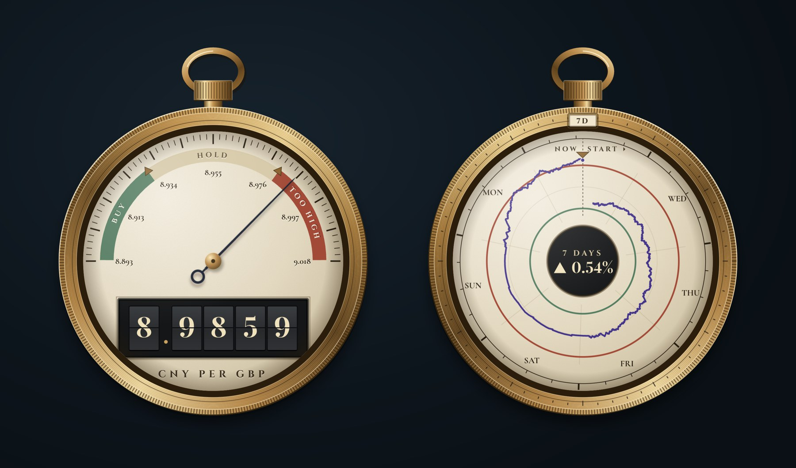
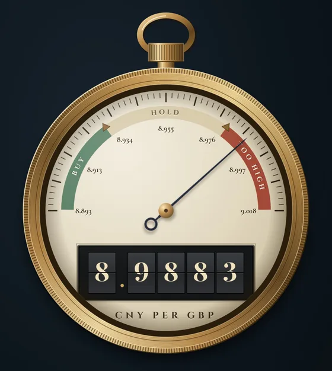
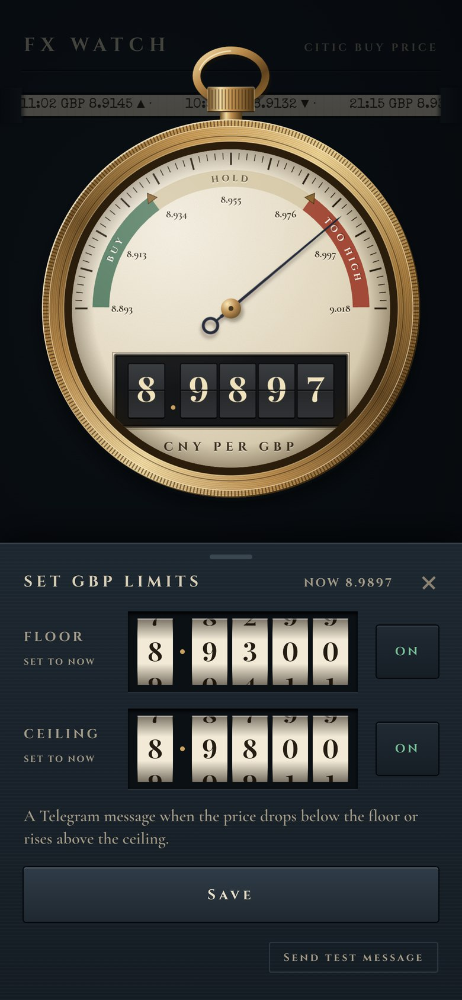
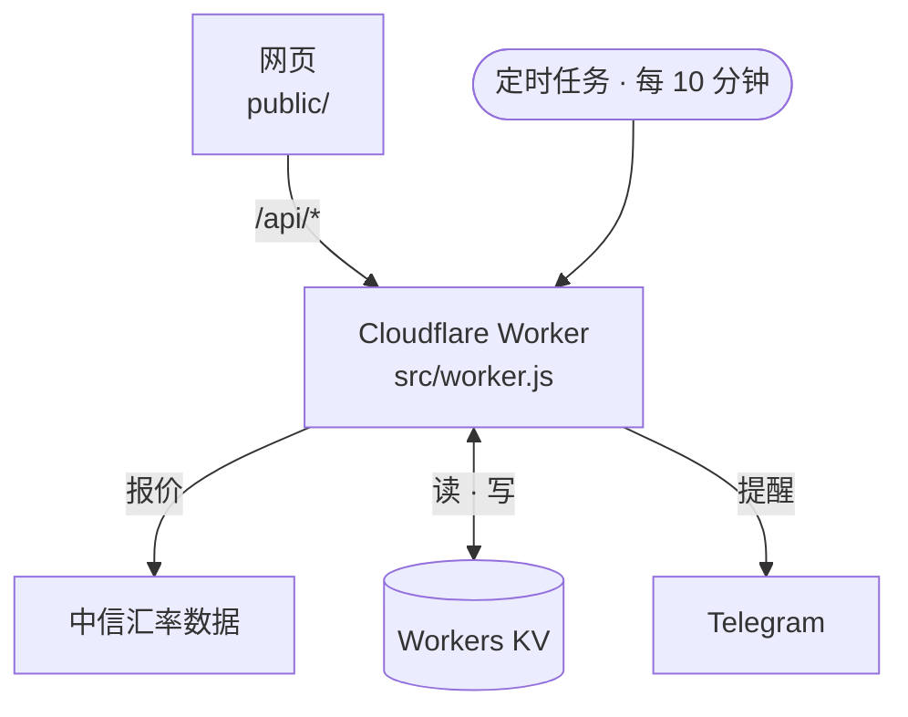

<div align="center">

# FX Watch

[](https://github.com/Ian9657/fx-watch/actions/workflows/test.yml)
[](LICENSE)

[English](README.md) | **简体中文**

**一块只看一个汇率的怀表。**

盯着中信银行英镑和美元的购汇价，记录历史走势，价格越过你设定的下限或上限时发 Telegram 消息提醒你。

[**fx.etarc.net**](https://fx.etarc.net) · Cloudflare Workers · 零依赖，无需构建

<br>



</div>

> [!NOTE]
> 价格来自中信银行官网汇率表背后的公开数据，仅供参考。实际交易以中信银行 App 中的价格为准。

## 为什么做这个

中信银行只公布当前的购汇价，不提供历史走势，也没有价格提醒。想等个好价格换汇，就只能一遍遍手动去查。FX Watch 每十分钟查一次，记下每个新报价，价格值得出手时通知你。

## 功能

### 正面

- **一眼看出价格处在什么位置。** 指针落在按你自己的下限和上限划分的表盘上，分为 **BUY · HOLD · TOO HIGH** 三段。
- **数字滚轮显示精确价格**，旁边有相对昨日收盘的涨跌，顶部的纸带滚动显示最近几次报价。
- **转动旋钮切换币种**，按一下表冠就是给表上弦，同时刷新数据。

### 背面

- **把表翻过来看历史。** 背面是一台圆形记录仪，可以看 24 小时、7 天、30 天或 90 天。
- **转动表圈切换时段**，当前时段显示在十二点位置的小窗里，像日历表的日期窗。
- **下限和上限在图上是两道圆环。** 休市期间没有新报价，曲线会保持最后的价格，直到下一个报价出现。

<p align="center"></p>

### 提醒

- **每个币种都能设下限和上限**，用数字滚轮调节，保存前表盘会先预览效果。
- **越过界限时发一条消息**，价格一直停在界外的话，每 4 小时再提醒一次。价格要回到界内超过 0.1% 才会重新开始监测，所以价格在界限附近来回波动时，不会反复收到提醒。
- **检查停了也会告诉你。** 如果每十分钟的检查连续失败，会发消息通知；恢复正常后再通知一次。

<p align="center"></p>

### 日常使用

- **像 App 一样安装**到 iPhone 主屏幕或 Mac 程序坞。没网时也能打开，显示最后一次的价格，并标注 OFFLINE。
- **每个控件都有手感。** 轻微的声音和触感反馈；如果系统设置了减弱动态效果，动画也会相应减少。

## 隐私

- **有密码保护。** 每台设备只需输入一次。没有密码，接口什么也不返回；比对密码时用的方法也防得住靠测量响应时间来猜密码。
- **数据都在你自己的 Cloudflare 账户里。** 上下限、提醒状态和价格历史都存在你的 Workers KV 中，历史记录 92 天后自动过期。
- **不连接任何其他服务。** Worker 只访问中信的汇率数据，发提醒时再访问 Telegram。页面不加载任何第三方脚本、字体或统计工具。

## 设计

整个界面就是一块怀表：藏青色、象牙白，加一只黄铜表壳。贯穿始终的几条规则：

- **只有一个光源，在左上方。** 每个零件的高光和阴影都和它一致。
- **每个零件都装在表上。** 不靠投影悬浮，所有部件都嵌在表里或装在表上。
- **金色只属于表。** 页面其余部分只用藏青和象牙白。
- **机械感来自动作，而不是装饰。** 滚轮会滚动，表圈只朝一个方向一格一格地转，指针从静止扫到位。不画任何齿轮。

这几条规则也写在 [`public/style.css`](public/style.css) 的开头。

## 工作原理



| 部分 | 位置 |
|---|---|
| 网页：页面的每个部分各是一个 ES 模块（表盘、纸带、背面、设置面板、共享状态、启动） | `public/`、`public/js/` |
| 接口：`/api/rates`、`/api/history`、`/api/settings`、`/api/test` | `src/worker.js` |
| 解析报价、提醒规则、消息文字（纯函数，有单元测试） | `src/logic.js` |
| 历史：按北京时间每天一条 KV 记录（`h:YYYY-MM-DD`），各自 92 天后过期，所以每次检查只读写当天这一条 | Workers KV |
| 离线副本：优先从网络获取，断网时用缓存 | `public/sw.js` |

全部用原生 JavaScript、HTML 和 CSS 写成：没有框架，没有打包工具，没有 npm 依赖。

## 开发

```sh
echo 'EDIT_PASSWORD=localtest' > .dev.vars
npm run dev            # http://localhost:8787
npm test               # 逻辑和 Worker 的单元测试
npm run check:screens  # 需先运行 dev：在无界面 Chrome 里检查六种屏幕尺寸
```

`check:screens` 会以手机和桌面的多种尺寸打开应用。每种尺寸下，它先检查页面是否刚好一屏放下、有没有报错，再把表翻过来、转动旋钮、拖动一个滚轮、打开设置面板。截图保存在 `screens/`。

## 部署

推送到 `main` 后，Cloudflare Workers Builds 会自动部署。Worker 的名字必须保持为 `fx-watch`。

在 Cloudflare 控制台（fx-watch → Settings → Variables and Secrets）里设置以下密钥：

| 名称 | 用途 |
|---|---|
| `EDIT_PASSWORD` | 打开应用、修改上下限用的密码 |
| `TELEGRAM_BOT_TOKEN` | 从 @BotFather 获取 |
| `TELEGRAM_CHAT_ID` | 你和机器人对话的 chat ID |

## 安装

- **iPhone：** 用 Safari 打开网站 → 分享 → 添加到主屏幕
- **Mac：** 用 Safari 打开网站 → 文件 → 添加到程序坞

## 致谢

字体（Cinzel、Cormorant Garamond、Playfair Display、Special Elite）均自行托管，遵循 SIL Open Font License。

## 许可证

[MIT](LICENSE)
